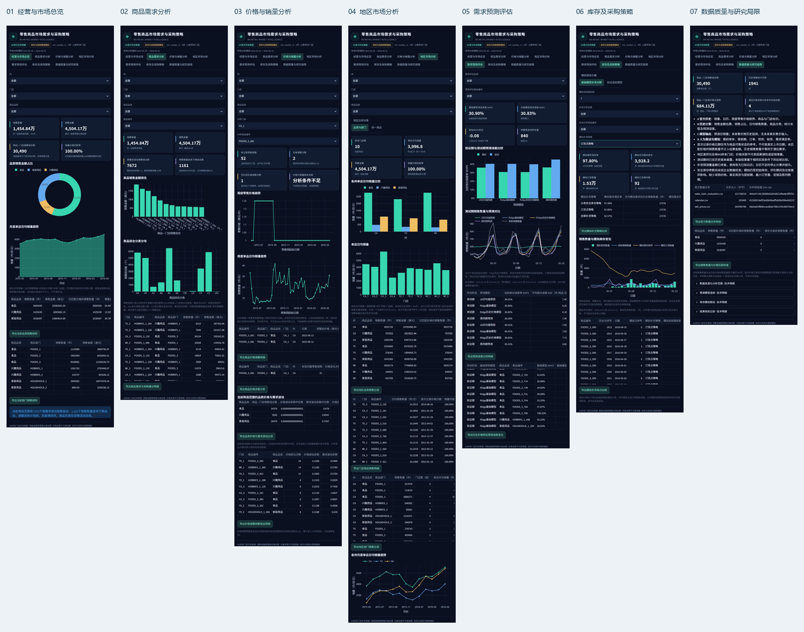

# 零售商品市场需求分析、销量预测与采购策略研究

基于现有M5项目的增量升级，面向采购管理、品类采购、供应链运营、产品与市场运营岗位。用真实销量与零售售价判断商品需求、品类销售金额贡献、价格关联和样本地区差异，再用同一组商品检验预测及补货策略。

**A 官方M5历史；B 历史计算；C 模型预测；D 库存与采购情景模拟。没有企业实际降本或沃尔玛真实库存改善主张。**



[查看七页完整截图与页面说明](docs/dashboard_gallery.md)

## 最终交付材料

- [代码、函数与行号证据索引](docs/19_market_evidence_index.md) · [统一业务术语](docs/20_business_terminology.md)

正式报告先给管理摘要，再按商品需求、价格与销量、地区差异、预测与补货权衡、行动建议展开，详细方法与研究限制集中在附录。

## 先看结果与讲解

- [市场与采购策略业务报告HTML](outputs/m5_market/market_business_report.html) · [PDF打印版](outputs/m5_market/market_business_report.pdf) · [Markdown](outputs/m5_market/market_business_report.md)
- [图表与数据来源对照](docs/22_chart_data_mapping.md)
- [完整方法](docs/10_market_methodology.md) · [数据字典](docs/11_market_data_dictionary.md)
- [市场商品](docs/12_market_report.md) · [价格销量](docs/13_price_sales_report.md) · [地区市场](docs/14_regional_market_report.md)
- [预测对照](docs/15_price_forecast_experiment.md) · [采购建议与修复对照](docs/16_procurement_recommendations.md) · [限制](docs/18_market_limitations.md)
- [阶段一审查和实施方案](docs/09_market_upgrade_plan.md) · [验证证据](validation.md) · [代码证据索引](docs/19_market_evidence_index.md)

GitHub直接显示Markdown；HTML需下载后打开。交互看板需本地启动。

## 分析范围和业务发现

- 市场研究覆盖3州10家样本门店、30,490个商品—门店销售组合。销量历史2011-01-29至2016-05-22，共1,941天；主要比较窗口为2015-05-25至2016-05-22的364天。
- 该窗口销量14,548,395件，按对应周售价估算销售金额45,041,697.91美元。金额不是利润或采购成本，当前销量价格匹配率100%。
- 食品贡献约55.69%的销售金额。WI食品销量份额约70.39%，CA约63.98%；按单店日均销量比较，食品销售数量很接近，不能直接据此判断偏好。
- 价格深度案例为原30个商品ID跨10店的300条序列，只有4条满足预设关联条件；163次变价中103次具备前后各4完整稳定价格周。证据不足不等于没有价格敏感性。
- 每条商品门店都有完整周需求CV、相邻56天趋势、售价CV和变价次数；月季年按实际统计天数计算日均销售数量。首价只是可售代理，价格销量统计关系不作因果解释。

## 预测对照：同30SKU、同时间窗口

原CA_1的30个SKU筛选严格截至首次验证前，验证为2016-02-29至04-24的两折28天，测试为04-25至05-22。

| 方法 | 验证WAPE | 测试WAPE | 测试MAE / 件SKU日 |
|---|---:|---:|---:|
| 周同期 | 45.51% | 36.28% | 7.4619 |
| 28日均值 | 40.51% | 36.01% | 7.4073 |
| 原Ridge | 40.42% | 30.90% | 6.3566 |
| Ridge加历史价格 | 39.93% | 30.83% | 6.3407 |

原方法7,560条预测逐行复现一致。新增历史价格模型只使用预测起点已知价格，28天递归内冻结最后已知价，冷启动使用缺价标记。alpha固定15，只由验证选择；没有测试驱动的追加特征搜索。

测试WAPE仅下降约0.08个百分点；30SKU中3个改善、12个恶化、15个基本不变，不能宣称普遍有效。测试窗口已在旧版本披露，新实验为固定协议下的后续比较，尚无跨时期稳定性或全新未见测试证据。WAPE不是准确率，也不是官方WRMSSE竞赛分数。

## 补货修复与决策边界

原simulate_one在销量末端缩短预测覆盖；新版保留官方已知未来日历，每次完整覆盖交期加复核期。缺少日历明确报错，不读未来真实销量或实际售价。新台账记录完整覆盖、目标库存、库存位置和PO到货日。

固定原Ridge、7天交期的对照：

| 策略 | 满足率修复前 | 修复后 | 平均库存前 / 件 | 修复后 / 件 |
|---|---:|---:|---:|---:|
| abc_xyz | 97.33% | 97.48% | 3803.9 | 3926.9 |
| rop | 97.65% | 97.80% | 3821.7 | 3928.2 |
| weekly_cover | 92.57% | 92.57% | 3532.1 | 3532.1 |

价格候选模型驱动的订货点模拟满足率为97.22%，低于修复后原Ridge的97.80%，同时平均库存略低。固定起点WAPE略好不代表每日滚动补货更好；两套方案均公开保留，未据测试模拟调参。

比较均为相同需求、期初、空在途和提前期的D模拟。新结果同时报告订货量、订货事件和期末在途。有限28天、14天期初覆盖及未校准安全库存仍影响结果。市场分析的全样本期后ABC没有传入测试期模拟，后者沿用预验证分类。

## 七页看板

经营与市场总览 → 商品需求分析 → 价格与销量分析 → 地区市场分析 → 需求预测评估 → 库存及采购策略 → 数据质量与研究局限。

支持州、门店、品类、SKU筛选和数据导出；预测SKU选择同步更新误差与曲线；库存交期同步更新策略指标、轨迹和台账。看板直接展示新版七页分析；历史基线结果文件独立保留，供结果核查与对照。

七页均提供从页首到页尾的[完整截图](docs/dashboard_gallery.md)。截图按浏览器实际滚动位置拼接，保留页面筛选状态；价格页展示CA_1的FOODS_3_681，库存页展示基础模型、7天交期下的订货点模拟。表格完整字段和明细通过页面CSV导出查看。

## 本地运行

```powershell
python -m pip install -r requirements.txt
python -m streamlit run app.py
```

仓库已有真实输出即可看板展示。重新计算需自行登录[Kaggle数据页](https://www.kaggle.com/competitions/m5-forecasting-accuracy/data)并同意条款，准备calendar.csv、sell_prices.csv、sales_train_evaluation.csv，放入data/raw。市场描述支持validation备用文件；原30SKU预测对照严格要求与已发布evaluation基线同商品、同日期，换validation会因基线不一致停止对照。

```powershell
python run_market.py --raw data/raw --out outputs/m5_market --stage all
python -m pytest -q
python make_report.py --out outputs/m5_market
```

可分阶段运行`--stage market`、`forecast`、`inventory`、`report`、`verify`；预测与库存阶段需要已有前序输出。本机真实CSV现位于D盘已提供的数据目录，运行时可用--raw传入该绝对路径。只会从本地读取原始数据，不将大CSV纳入仓库。

原run.py和合成演示仍保留，真实默认输出改为outputs/m5_market/core_reproduction；演示使用outputs/demo并明确标记，不用于真实成果。

## 基线、版本和证据

`outputs/m5`的11个已发布文件完整保留。原30SKU测试Ridge30.90%、均值36.01%作为历史基线，新结果仅写`outputs/m5_market`。market_manifest.json记录数据哈希与窗口，model_selection.json记录测试计算前的验证选择，inventory_manifest.json记录共同假设，verification.json核对输出与库存守恒。当前验证记录见[验收说明](validation.md)。

原[SKU完整案例](docs/07_business_case.md)、[历史审查](docs/08_business_logic_review.md)及7页PDF仍可查阅，属于历史版本，不与市场新窗口混用。原publication_manifest.json仅说明旧发布版本。

缺少真实在手库存、采购价、供应商订单、真实交期、MOQ、缺货、促销、陈列和客流信息。项目可提出采购和运营复核建议，尚不能直接执行采购、识别因果弹性或证明企业降本。项目基于用户提供的工程，由AI辅助实现；不虚构独立开发经历或数据授权。
