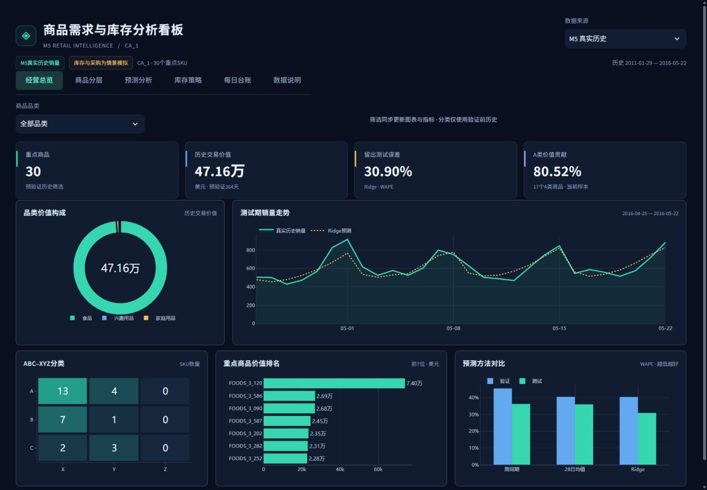
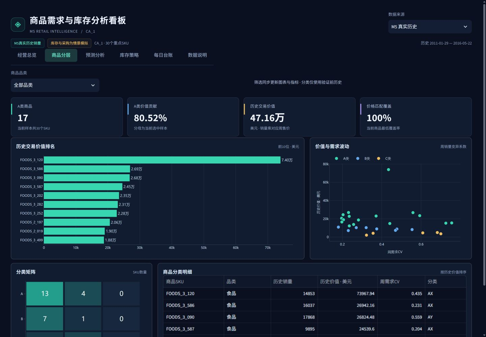
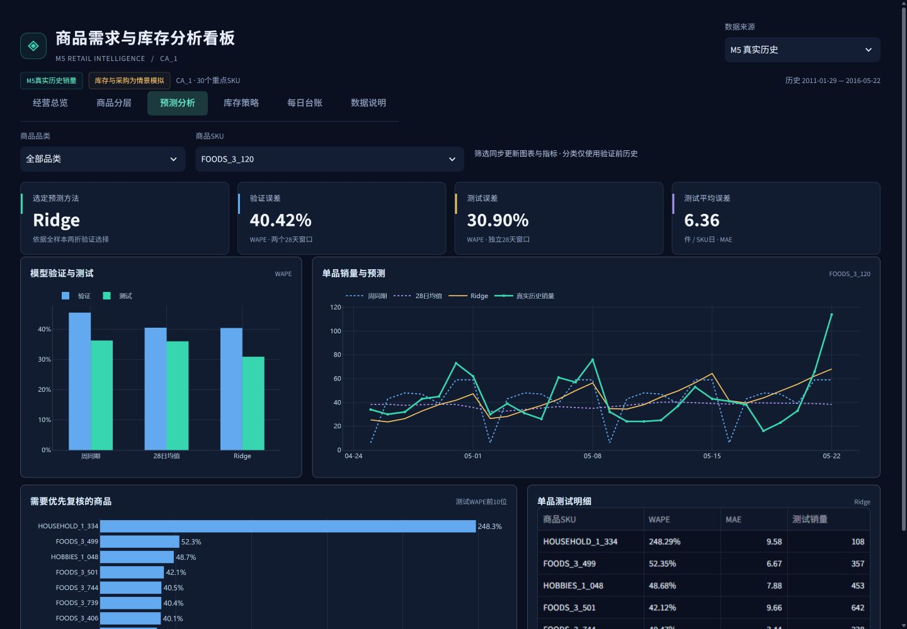
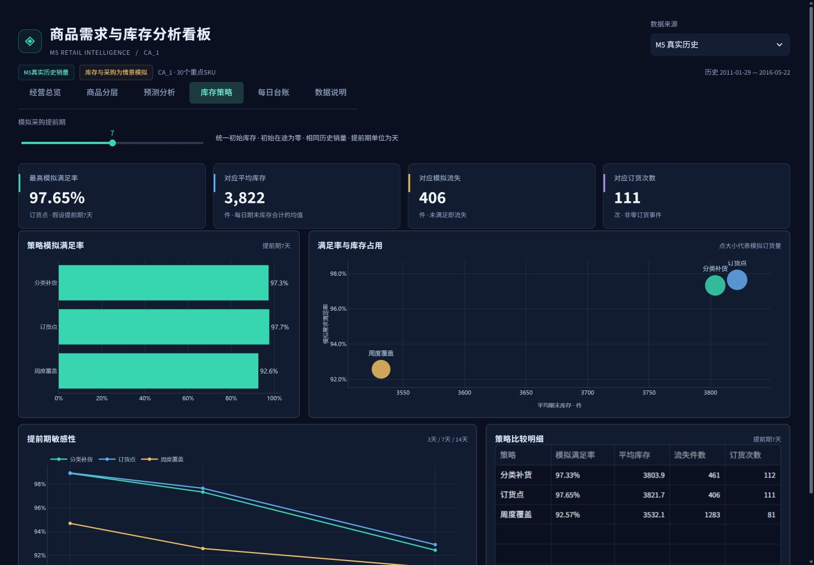
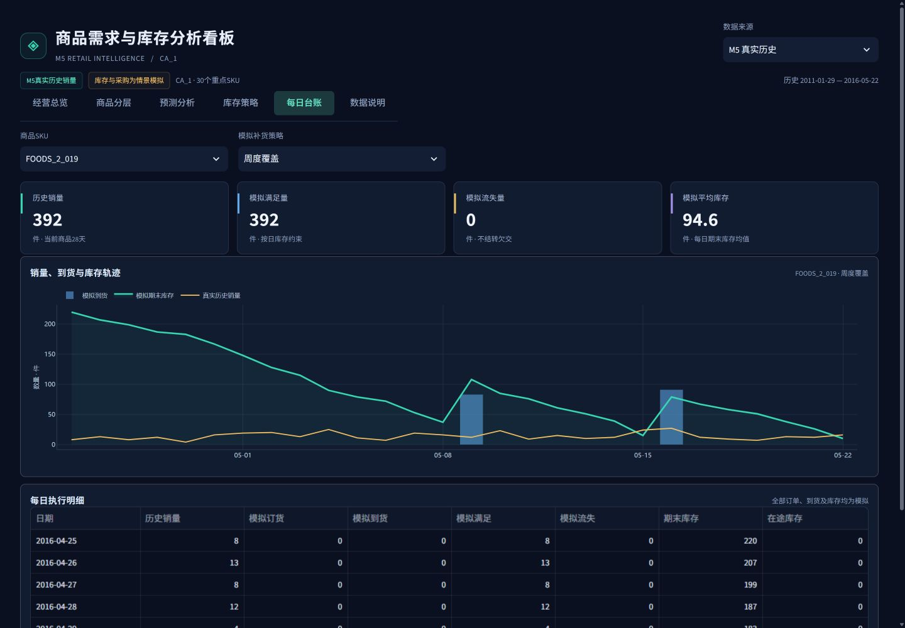
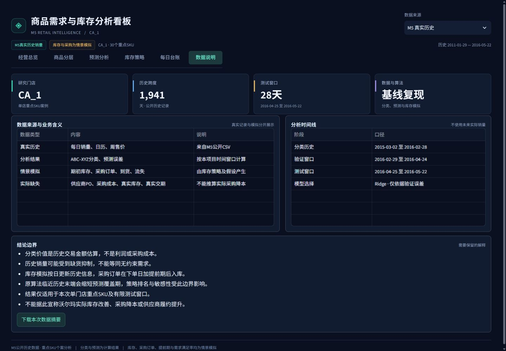

# M5 SKU需求预测与库存补货策略分析

面向采购计划、供应链运营与需求计划岗位的个人项目。以CA_1门店30个重点SKU为案例，连接商品分层、销量预测、补货决策、在途到货与库存评价。

**真实销售历史驱动分析；库存、采购订单、提前期和履约结果均为情景模拟。**



## 业务问题

计划人员需要回答：先管理哪些商品？未来可能卖多少？库存降到什么水平应下单？下单后何时到货？保障需求需要占用多少库存？

本项目使用M5公开历史销量、周售价和日历，通过相同条件下的三种补货规则比较，展示需求满足与库存占用之间的取舍。它支持分析与方法讨论，没有连接企业采购系统。

## 先看这些内容

- [完整SKU案例：FOODS_3_120](docs/07_business_case.md)
- [业务逻辑审查与已知限制](docs/08_business_logic_review.md)
- [7页业务报告PDF](outputs/m5/project_report.pdf) · [离线HTML报告](outputs/m5/project_report.html)
- [方法与指标口径](docs/01_methodology.md) · [验证证据](validation.md)
- [源代码](src/core.py) · [真实结果摘要](outputs/m5/summary.json)

## 真实历史计算结果

| 范围 | 本次已保存结果 |
|---|---|
| 门店与商品 | CA_1，30个预验证历史高销量且活跃的SKU |
| 历史区间 | 2011-01-29至2016-05-22，共1,941天 |
| 筛选与分类 | 2015-03-02至2016-02-28，共364天 |
| 验证 | 两个连续28天窗口，2016-02-29至2016-04-24 |
| 独立测试 | 2016-04-25至2016-05-22，共28天 |
| 历史价值 | 选中样本合计471,623.77美元，按销量乘对应周售价估算 |
| A类 | 17个SKU，占选中样本历史价值80.52% |

价值贡献的分母仅为选中30个SKU，销售价值不代表利润或采购成本。样本按销量筛选，不能外推全部商品。

| 预测方法 | 验证WAPE | 测试WAPE | 测试MAE，件/SKU日 |
|---|---:|---:|---:|
| 周同期 | 45.51% | 36.28% | 7.46 |
| 28日均值 | 40.51% | 36.01% | 7.41 |
| Ridge | **40.42%** | **30.90%** | **6.36** |

两个验证窗口汇总选择全样本统一方法Ridge，最后28天单独测试。Ridge在验证期仅略优于均值方法，不能据此认定其普遍更优。WAPE不是“准确率”，也不是M5官方WRMSSE竞赛分数。

## 库存策略情景结果

下表使用相同的官方历史销量作为需求冲击，但所有库存与采购执行均为模拟。共同设置为7天采购提前期、相同期初库存、初始在途为零、未满足需求直接流失。

| 模拟策略 | 需求满足率 | 流失件数 | 平均期末库存，件 | 非零订货事件 |
|---|---:|---:|---:|---:|
| 周度覆盖 | 92.57% | 1,283 | 3,532.1 | 81 |
| 订货点 | **97.65%** | **406** | 3,821.7 | 111 |
| 分类补货 | 97.33% | 461 | 3,803.9 | 112 |

订货点相对周度覆盖，模拟满足率高约5.08个百分点，平均库存多约289.5件。分类补货没有全面优于普通订货点。该结果展示策略权衡，不代表沃尔玛实际缺货改善、库存优化或采购降本。

**已知边界：原算法临近历史末端会缩短预测覆盖期，影响末端补货、库存及敏感性排序。当前保留原计算基线，没有声称长期最优策略。**

## 业务流程


预测每个SKU在CA_1门店的日销量；模型按SKU分别训练，方法按全样本验证误差统一选择。补货时每日更新历史特征，Ridge参数保持测试起点训练版本；因此补货预测与固定起点28天预测的口径需要区分。

## 六页看板

| 页面 | 决策用途 | 主要输出 |
|---|---|---|
| 经营总览 | 快速掌握样本价值、预测表现 | 总体指标、销量趋势、价值构成 |
| 商品分层 | 确定重点复核对象 | ABC-XYZ矩阵、价值排名、波动分布 |
| 预测分析 | 比较方法、查看单品偏差 | 验证测试误差、单品预测曲线 |
| 库存策略 | 讨论服务与库存取舍 | 三策略结果、3/7/14天提前期情景 |
| 每日台账 | 追踪下单、到货和库存变化 | 基线7天提前期的单品逐日记录 |
| 数据说明 | 明确来源、窗口与限制 | 真实记录、计算、预测、模拟边界 |

<details><summary>展开其他页面截图</summary>







</details>

截图来自既有真实结果的本地看板。GitHub仓库提供代码和静态展示，交互看板需本地启动。

## 快速查看与复现

仅查看既有真实分析，不需要下载原始CSV：

```powershell
python -m venv .venv
.venv\Scripts\Activate.ps1
python -m pip install -r requirements-tested.txt
python -m streamlit run app.py
```

顶部选择“M5 真实历史”。`requirements-tested.txt`记录已有本地环境的直接依赖版本；`requirements.txt`保留原项目依赖范围。尚未在所有系统上验证安装兼容性。

重新计算需要自行从[Kaggle竞赛数据页](https://www.kaggle.com/competitions/m5-forecasting-accuracy/data)登录并接受数据条款，放置CSV到`data/raw`。为了保留仓库已发布基线，请输出到新目录：

```powershell
python run.py --raw data/raw --store CA_1 --top-n 30 --lead-days 7 --out outputs/reproduced
python make_report.py --out outputs/reproduced
```

本仓库没有打包官方原始数据。使用validation版销量会改变分析窗口，不能期待复现evaluation版完全相同的指标。

运行测试：

```powershell
python -m pytest -q
```

现有测试证据为9项通过，覆盖时间泄漏、提前期、库存守恒等；合成测试夹具仅验证程序性质。可单独运行演示，结果与真实基线分开：

```powershell
python run.py --demo --top-n 18
```

## 数据与结论边界

- A 官方M5历史：销量、日期、商品门店标识、周售价。
- B 历史计算：ABC-XYZ、历史价值、验证及测试误差。
- C 模型预测：未来日销量估计，允许小数，不等于实际销量。
- D 假设模拟：库存、PO、提前期、到货、流失和需求满足率。

M5缺少真实在手库存、供应商订单、采购价、交期、MOQ和缺货标签。没有成本模型与库存周转指标。真实销量也可能受到原有缺货抑制。完整问题见[逻辑审查](docs/08_business_logic_review.md)。

项目基于用户提供的独立代码包，由AI辅助完成复现、看板与文档整理；没有将其描述为企业实施或全部代码独立手写。原始代码包未提供可核实上游地址，本仓库不臆造上游或添加未经确认的开源许可。数据权利与使用条件归原来源约束。
