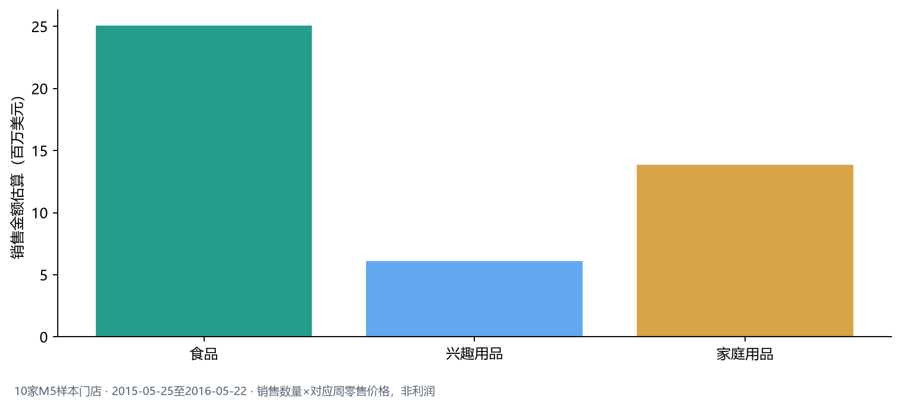
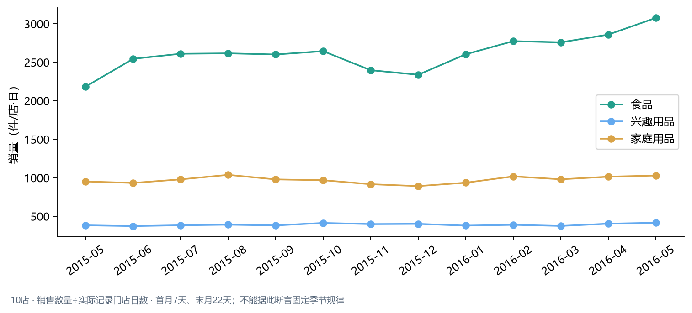

## 一、商品需求与品类结构

### 食品贡献过半销售金额，内部差异决定管理优先级

分析窗口为2015-05-25至2016-05-22，覆盖全部10家样本门店。食品销售金额估算为$25.08百万，占总额55.69%；按零售售价估算，不代表利润或采购成本。

| 商品类别 | 销售数量（件） | 销售金额估算（百万美元） | 销售金额占比 |
|---|---|---|---|
| 食品 | 9,584,559 | 25.08 | 55.69% |
| 兴趣用品 | 1,425,439 | 6.10 | 13.53% |
| 家庭用品 | 3,538,397 | 13.86 | 30.78% |

食品最近56天单店日均销量为2,899件，较此前相同长度窗口+3.30%。食品内部有2,899个高波动组合，说明品类整体增长并不意味着每个商品都稳定。建议把高金额、增长且波动可控的商品纳入供货跟踪；高波动商品单独复核预测与可售情况，不对整个品类统一加库存。

### 连续下降和高波动是复核信号，不是直接删品结论

| 识别情形 | 商品—门店组合数 | 管理动作 |
|---|---:|---|
| 连续两个56天阶段销量均下降超过20% | 1,161 | 先核查断货、下架、替代品及活动结束，再调整覆盖量 |
| 周需求波动较高且全年至少销售20件 | 7,672 | 对具体商品复核补货频率与库存缓冲 |

销售金额较高的下降案例：

| 门店 | 商品 | 销售金额估算（美元） | 较早阶段日均销量（件） | 前一阶段日均销量（件） | 最近阶段日均销量（件） |
|---|---|---|---|---|---|
| CA_3 | FOODS_1_012 | 14,002.92 | 7.91 | 5.45 | 0.54 |
| TX_3 | FOODS_2_183 | 11,808.70 | 3.25 | 2.34 | 0.27 |
| CA_1 | HOUSEHOLD_1_413 | 10,422.60 | 2.11 | 1.48 | 0.82 |

例如CA_3的FOODS_1_012三个56天阶段日均销量由7.91降至5.45，再降至0.54件。数据没有在架或缺货记录，因此当前只能将其列为待查对象。

首月和末月分别只有7天和22天，已按实际记录门店日计算单店日均销量。活动、商品上市和在架变化尚未剥离，月度走势适合作为进一步核查的线索。

完整上下文见[业务报告](../outputs/m5_market/market_business_report.md)。
