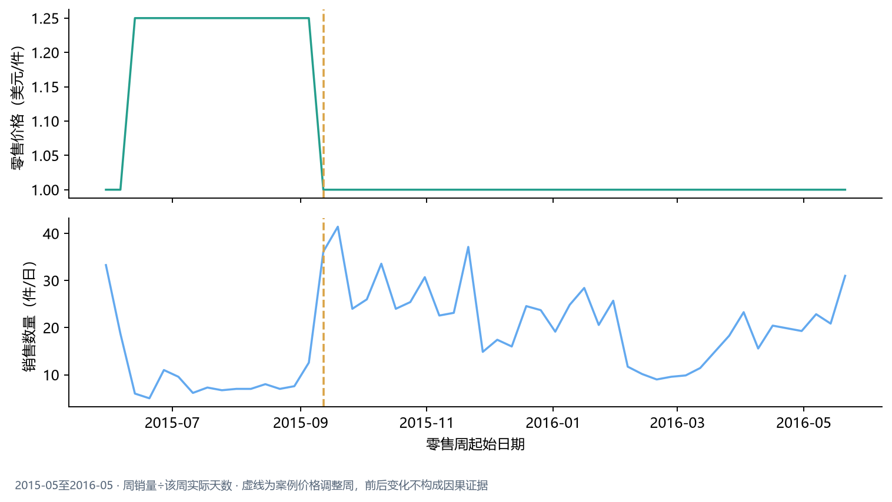

## 二、价格与销量关系

### 价格案例值得复盘，但目前不能推导普遍价格敏感度

CA_1的FOODS_3_681在2015-09-12当周零售价由$1.25降至$1.00，调整前后各4个完整周的日均销量由8.79升至31.89件，观察变化为+263%。

这是前后同时段的观察比较，不是“降价导致销量增长”。研究没有完整促销、陈列、缺货或竞品信息，也没有未调价对照组。300个候选商品—门店组合中仅4个通过预设分析条件，因此不足以支持普遍弹性结论。建议将该案例列入活动备货复盘：核对促销计划、到货和在架记录，再评估是否需要提高活动期间的备货量。

完整上下文见[业务报告](../outputs/m5_market/market_business_report.md)。
