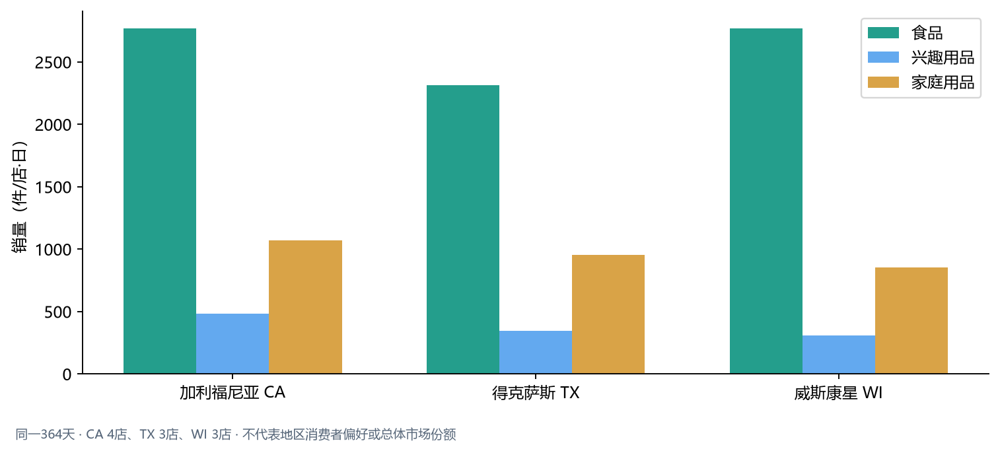

## 三、地区与门店差异

### WI食品销售占比更高，但与CA单店日均销量接近

同一364天内，WI食品销量占比为70.39%，CA为63.98%；食品单店日均销量分别为2,771和2,770件。占比差异可能受到各品类构成影响，不能直接解释为WI食品绝对需求更旺。

建议先在相同商品、相同门店周期内比较，再把差异用于门店配置复核。样本仅覆盖CA 4店、TX 3店和WI 3店，不代表州或全美市场份额；门店规模、客流及在架信息未纳入。

完整上下文见[业务报告](../outputs/m5_market/market_business_report.md)。
