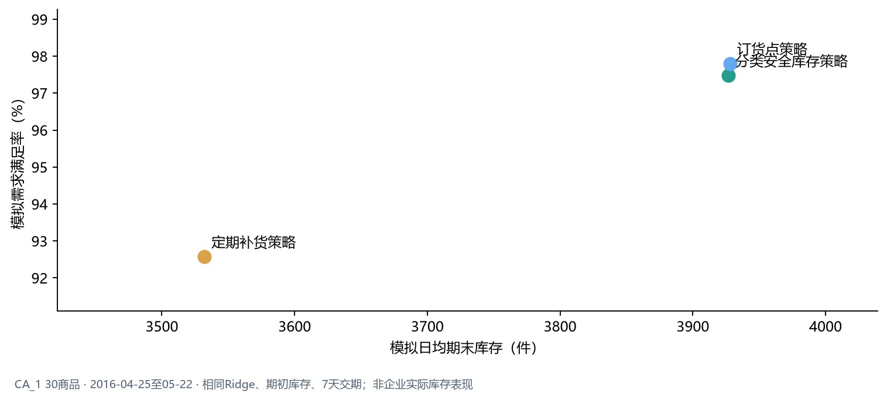

### 补货策略需要同时权衡保障水平与库存占用

订货点是在库存位置降至提前期需求与安全库存之和时下单。7天提前期的情景模拟中：

| 模拟策略 | 需求满足率 | 缺货件数 | 平均期末库存（件） | 模拟订货量（件） | 订单事件数 |
|---|---:|---:|---:|---:|---:|
| 定期补货 | 92.57% | 1,283 | 3,532 | 12,628 | 100 |
| 订货点 | 97.80% | 380 | 3,928 | 15,319 | 92 |
| 分类安全库存 | 97.48% | 436 | 3,927 | 15,045 | 90 |

相对定期补货，订货点情景减少903件模拟缺货，同时增加约396件日均期末库存。历史价格模型虽然固定28天预测WAPE略低，但递归补货中的缺货件数反而多101件，说明预测误差与下单、到货时点共同影响库存结果。

真实采购价、持有成本、缺货成本、供应商交期和MOQ均缺失；因此只能比较情景，不能判定经济最优或宣称真实库存改善。

完整上下文见[业务报告](../outputs/m5_market/market_business_report.md)。
