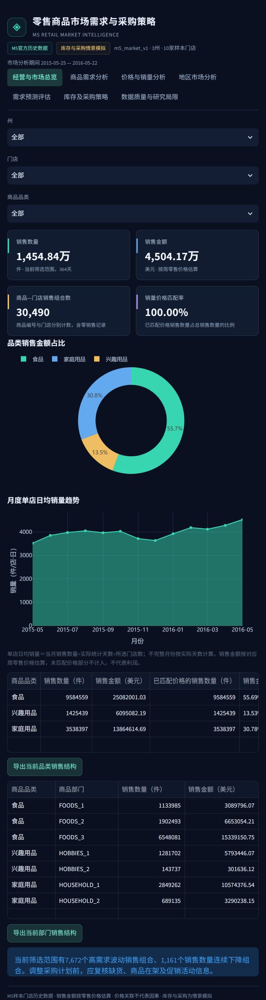
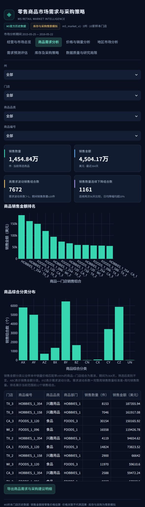
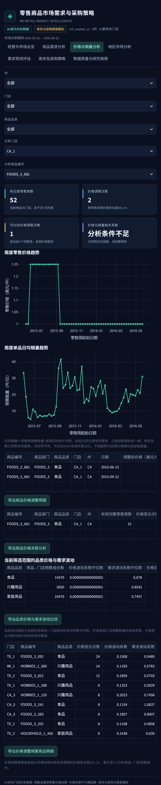
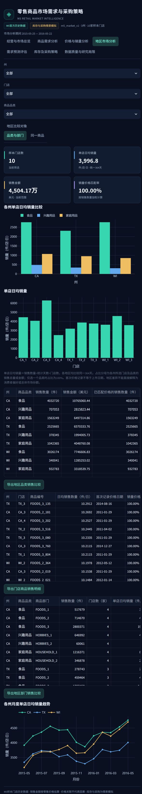
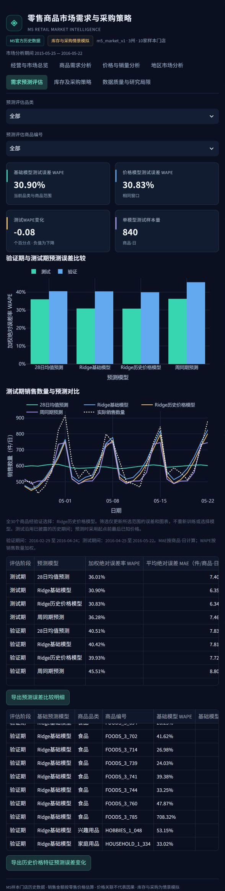
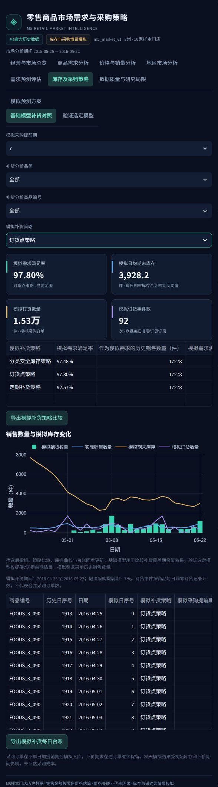
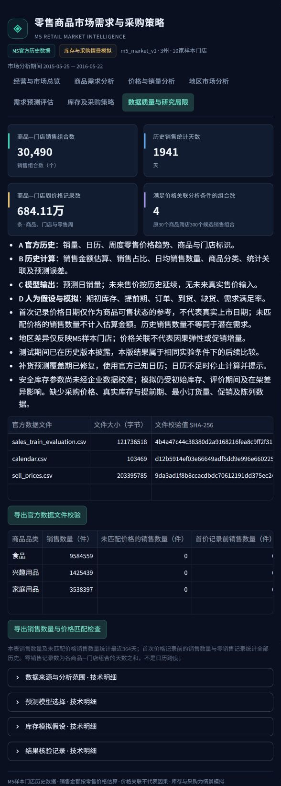

# 七页看板完整截图

截图来自已运行的新版Streamlit看板，覆盖页面标题、筛选器、指标、图表、明细表与页尾。浏览器内部滚动区域按实际滚动位置逐屏拼接，未改写图表或数据；完整表格字段和全部记录可从看板导出CSV。

市场分析期间为2015-05-25至2016-05-22。市场页面默认包含3州10家样本门店；预测和库存页面仅覆盖CA_1的30个预验证重点商品。以下图片可点击查看原图。

## 1. 经营与市场总览

查看销售规模、品类金额结构、月度单店日均销量及部门结构。金额按零售售价估算。

## 2. 商品需求分析

查看商品金额排名、ABC-XYZ分类、高波动与连续下降信号，以及采购复核建议。分类用于历史分析，不代表利润贡献。

## 3. 价格与销量分析

截图选择CA_1的FOODS_3_681，展示周售价、日均销量、变价事件及分析条件。价格与销量变化仅构成复盘线索，不能解释为因果弹性。

## 4. 地区市场分析

比较相同期间各州与门店的单店日均销量、品类结构及月度走势，避免因门店数量不同而直接比较总量。

## 5. 需求预测评估

查看同一组30个SKU的验证、测试误差与销售数量预测曲线。测试WAPE为基础Ridge 30.90%、加入历史售价30.83%，改善幅度有限。

## 6. 库存及采购策略

截图选择基础模型、7天假设提前期、全部30个SKU和订货点策略，模拟满足率97.80%、平均期末库存3,928.2件。库存、订单、交期与缺货均为情景模拟。

## 7. 数据质量与研究局限

说明原始数据范围、价格匹配、真实记录与模型/模拟结果的边界，并提供字段字典和方法说明。

返回[项目首页](../README.md)或阅读[市场与采购策略业务报告](../outputs/m5_market/market_business_report.md)。
