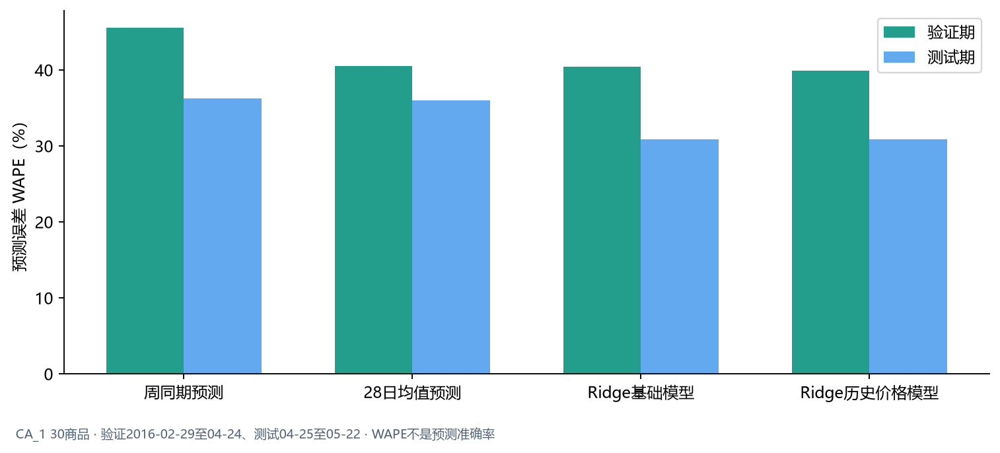

# 零售商品市场需求分析、销量预测与采购策略研究

M5公开历史销售分析｜3州10店｜市场窗口 2015-05-25 至 2016-05-22

## 管理摘要

本报告分析M5公开零售历史：3州10家样本门店的品类需求与售价表现，并对CA_1的30个重点商品评估预测和补货情景。历史销售是已实现销量；采购订单、库存、交期和缺货结果为模拟。

**食品是销售结构核心。** 食品贡献样本销售金额的55.69%，最近56天单店日均销量较前一阶段+3.30%。建议优先复核高金额食品商品的供货、预测偏差和可售状态。

**下降信号需要逐项排查。** 1,161个商品—门店组合连续两个56天阶段销量下降超过20%。这提示建立异常复核清单，但不能单凭销量判断商品衰退，应先排查缺货、下架和替代。

**地区占比不等同于单店需求。** WI食品销量占比为70.39%，CA为63.98%；食品单店日均销量分别为2,771和2,770件，接近。配置应进一步落到门店和具体商品。

**价格案例值得复盘，尚不能推出普遍弹性。** FOODS_3_681在CA_1由每件$1.25降至$1.00，前后可比窗口日均销量上升263%；但300个候选商品—门店组合仅4个达到关联分析条件，促销、陈列和缺货等因素未被完整控制。

**更低预测误差带来的改善很小，库存取舍仍需共同评估。** 历史价格模型测试WAPE为30.83%，基础Ridge为30.90%，差0.08个百分点。模拟订货点策略提高满足率，同时增加平均库存；这不是实际企业绩效。

**管理重点：** 按销售金额、近期趋势和波动筛出复核对象；把价格变动周作为活动复盘线索；用同店同品的单店日均支持地区配置；在真实库存、促销和供应商数据补齐前，将预测和补货结果用于方案比较，不用于自动下单。

<!-- PAGEBREAK -->

## 一、商品需求与品类结构

### 食品贡献过半销售金额，内部差异决定管理优先级

分析窗口为2015-05-25至2016-05-22，覆盖全部10家样本门店。食品销售金额估算为$25.08百万，占总额55.69%；按零售售价估算，不代表利润或采购成本。

| 商品类别 | 销售数量（件） | 销售金额估算（百万美元） | 销售金额占比 |
|---|---|---|---|
| 食品 | 9,584,559 | 25.08 | 55.69% |
| 兴趣用品 | 1,425,439 | 6.10 | 13.53% |
| 家庭用品 | 3,538,397 | 13.86 | 30.78% |

食品最近56天单店日均销量为2,899件，较此前相同长度窗口+3.30%。食品内部有2,899个高波动组合，说明品类整体增长并不意味着每个商品都稳定。建议把高金额、增长且波动可控的商品纳入供货跟踪；高波动商品单独复核预测与可售情况，不对整个品类统一加库存。

### 连续下降和高波动是复核信号，不是直接删品结论

| 识别情形 | 商品—门店组合数 | 管理动作 |
|---|---:|---|
| 连续两个56天阶段销量均下降超过20% | 1,161 | 先核查断货、下架、替代品及活动结束，再调整覆盖量 |
| 周需求波动较高且全年至少销售20件 | 7,672 | 对具体商品复核补货频率与库存缓冲 |

销售金额较高的下降案例：

| 门店 | 商品 | 销售金额估算（美元） | 较早阶段日均销量（件） | 前一阶段日均销量（件） | 最近阶段日均销量（件） |
|---|---|---|---|---|---|
| CA_3 | FOODS_1_012 | 14,002.92 | 7.91 | 5.45 | 0.54 |
| TX_3 | FOODS_2_183 | 11,808.70 | 3.25 | 2.34 | 0.27 |
| CA_1 | HOUSEHOLD_1_413 | 10,422.60 | 2.11 | 1.48 | 0.82 |

例如CA_3的FOODS_1_012三个56天阶段日均销量由7.91降至5.45，再降至0.54件。数据没有在架或缺货记录，因此当前只能将其列为待查对象。

首月和末月分别只有7天和22天，已按实际记录门店日计算单店日均销量。活动、商品上市和在架变化尚未剥离，月度走势适合作为进一步核查的线索。

## 二、价格与销量关系

### 价格案例值得复盘，但目前不能推导普遍价格敏感度

CA_1的FOODS_3_681在2015-09-12当周零售价由$1.25降至$1.00，调整前后各4个完整周的日均销量由8.79升至31.89件，观察变化为+263%。

这是前后同时段的观察比较，不是“降价导致销量增长”。研究没有完整促销、陈列、缺货或竞品信息，也没有未调价对照组。300个候选商品—门店组合中仅4个通过预设分析条件，因此不足以支持普遍弹性结论。建议将该案例列入活动备货复盘：核对促销计划、到货和在架记录，再评估是否需要提高活动期间的备货量。

## 三、地区与门店差异

### WI食品销售占比更高，但与CA单店日均销量接近

同一364天内，WI食品销量占比为70.39%，CA为63.98%；食品单店日均销量分别为2,771和2,770件。占比差异可能受到各品类构成影响，不能直接解释为WI食品绝对需求更旺。

建议先在相同商品、相同门店周期内比较，再把差异用于门店配置复核。样本仅覆盖CA 4店、TX 3店和WI 3店，不代表州或全美市场份额；门店规模、客流及在架信息未纳入。

## 四、需求预测与采购判断

### 历史价格信息只带来很小的测试误差变化

预测问题是：历史销量、日历和预测时点已知的价格信息，能否更好地预估未来28天销售数量？价格方案只沿用预测起点前最后已知售价，不读取未来实际售价。

| 方法 | 测试WAPE | 测试MAE（件/商品·日） |
|---|---:|---:|
| 周同期法 | 36.28% | 7.46 |
| 28日均值法 | 36.01% | 7.41 |
| Ridge基础模型 | 30.90% | 6.36 |
| Ridge加入历史售价 | 30.83% | 6.34 |

测试误差分别以840个商品·日、17,278件实际销量为比较基础。价格方案相对基础Ridge仅改善0.08个百分点，30个商品中3个误差下降、12个上升、15个基本不变。WAPE是销量加权误差率，不是“预测准确率”。这一结果不支持宣称价格特征显著提升预测。

### 补货策略需要同时权衡保障水平与库存占用

订货点是在库存位置降至提前期需求与安全库存之和时下单。7天提前期的情景模拟中：

| 模拟策略 | 需求满足率 | 缺货件数 | 平均期末库存（件） | 模拟订货量（件） | 订单事件数 |
|---|---:|---:|---:|---:|---:|
| 定期补货 | 92.57% | 1,283 | 3,532 | 12,628 | 100 |
| 订货点 | 97.80% | 380 | 3,928 | 15,319 | 92 |
| 分类安全库存 | 97.48% | 436 | 3,927 | 15,045 | 90 |

相对定期补货，订货点情景减少903件模拟缺货，同时增加约396件日均期末库存。历史价格模型虽然固定28天预测WAPE略低，但递归补货中的缺货件数反而多101件，说明预测误差与下单、到货时点共同影响库存结果。

真实采购价、持有成本、缺货成本、供应商交期和MOQ均缺失；因此只能比较情景，不能判定经济最优或宣称真实库存改善。

## 五、采购与运营行动建议

| 数据发现 | 建议行动 | 优先对象 | 下一步核查 |
|---|---|---|---|
| 食品销售金额占比55.69%，近56天单店日均销量增长+3.30% | 建立每周供货复核清单，查看预测偏差、库存与到货进度 | 高销售金额且近期增长的食品SKU，例如CA_1的FOODS_3_120 | 在架状态、促销计划、实际库存和到货日期 |
| 1,161个组合连续两阶段销量下降超过20% | 先查异常再调整补货覆盖，避免把断货当成需求下降 | CA_3的FOODS_1_012等高金额下降组合 | 缺货、下架、替代品、促销结束情况 |
| 价格分析有个案，符合关联条件的组合仅4个 | 对调价周开展活动复盘，记录销量、库存、陈列及促销 | 有足够价格变动和销量记录的商品 | 促销投入、未调价对照、供应恢复情况 |
| WI食品占比高于CA，但单店日均接近 | 按具体门店与SKU核定配置，试行差异化陈列或货架组合 | 同期、同品类、相同商品 | 门店规模、客流、在架及售价 |
| 价格模型测试WAPE仅改善0.08个百分点，模拟缺货结果未同步改善 | 保留简单基线，跨更多滚动窗口联合评价误差、库存、缺货和订单 | 30个预测SKU的下一轮验证 | 更多时间窗口、真实供应与成本参数 |

这些行动用于安排复核和后续验证，不表示已在沃尔玛或其他零售企业实施。

## 附录A：范围、口径与方法

### 数据范围

官方M5历史数据涵盖3州10店、30,490个商品—门店组合，历史范围2011-01-29至2016-05-22，共1,941天。本次市场窗口为2015-05-25至2016-05-22，共364天；销售数量14,548,395件，按匹配周零售价估算销售金额$45,041,698，销量价格匹配率100%。价格不是采购成本。

预测仅使用CA_1预验证历史筛选的30个SKU，验证为两段28天窗口，测试为2016-04-25至2016-05-22。每方法验证1,680个商品·日、测试840个商品·日，测试实际销量17,278件。市场全样本结果和30 SKU预测结果分属不同范围。

### 关键指标定义

- 单店日均销量＝销售数量÷有记录的门店日数。首末不完整月份按各自实际记录日计算。
- 销售金额估算＝销售数量×对应周零售售价。不是利润、采购成本或净销售额。
- 销售金额占比＝对应类别销售金额估算÷同一分析范围全部类别销售金额估算。
- 高波动组合＝完整周销量变异系数CV大于1，且全年销售至少20件；CV＝总体标准差÷均值。
- 连续下降组合＝连续两个56天阶段的单店日均销量均下降超过20%。这是筛查阈值，不是自动淘汰规则。
- WAPE＝全部商品日绝对误差之和÷全部商品日实际销售数量之和。MAE＝商品日绝对误差均值。
- 模拟需求满足率＝模拟履约数量÷历史销量驱动需求数量。模拟库存、采购订单和缺货不属于M5真实字段。

### 预测与补货约束

模型在每个预测起点只使用之前实际销量和当时已知特征，未来28天递归使用模型自身预测；历史售价信息以预测起点最后已知值延续，不读取预测期实际价格。周同期、28日均值和Ridge基础模型均保留。仅验证窗口用于方法选择，测试窗口用于既定方案评估。

库存情景采用7天交期、测试前84天日均销量乘14作为期初库存、期初在途为零。订货点策略按提前期需求和安全库存设触发阈值。订单在下单日加提前期后才入库，策略共享相同需求序列、初始条件、模型和交期。采购成本、持有成本、缺货成本、MOQ和真实PO均未提供。

### 研究边界

历史销售受库存与在架约束，不等于全部潜在需求；价格关联不能证明因果；3州10店不能代表全美市场；30个预测商品不能代表全部SKU。模拟改善不能表述为企业降本、真实缺货下降或沃尔玛运营绩效提升。

完整方法、字段字典和代码定位见[方法说明](../../docs/10_market_methodology.md)、[数据字典](../../docs/11_market_data_dictionary.md)及[代码证据索引](../../docs/19_market_evidence_index.md)。
